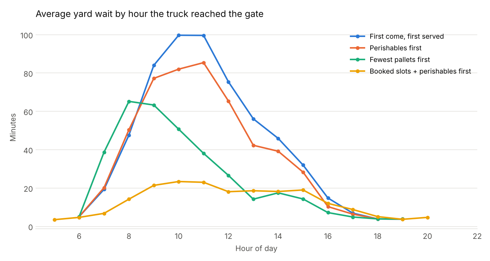
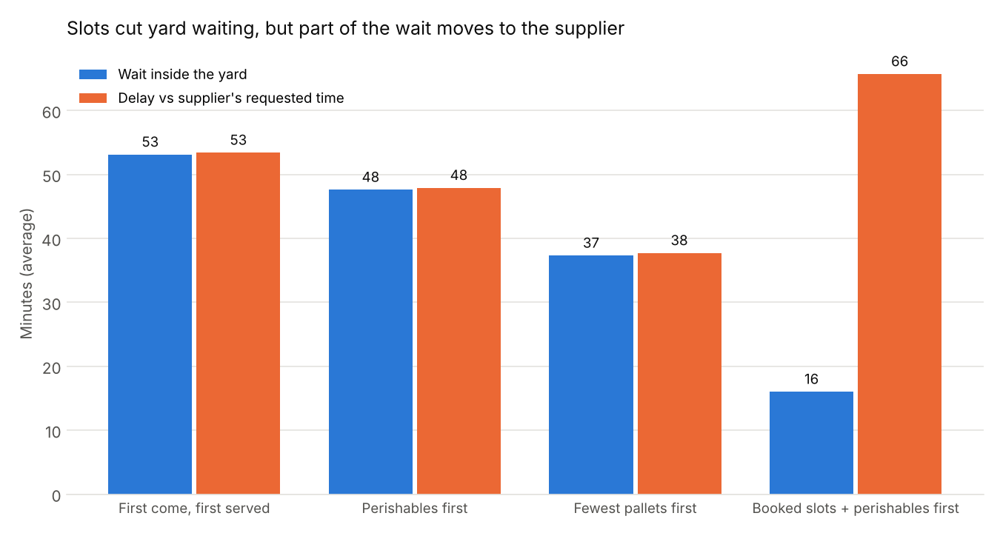
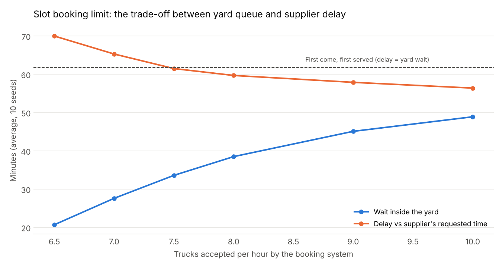
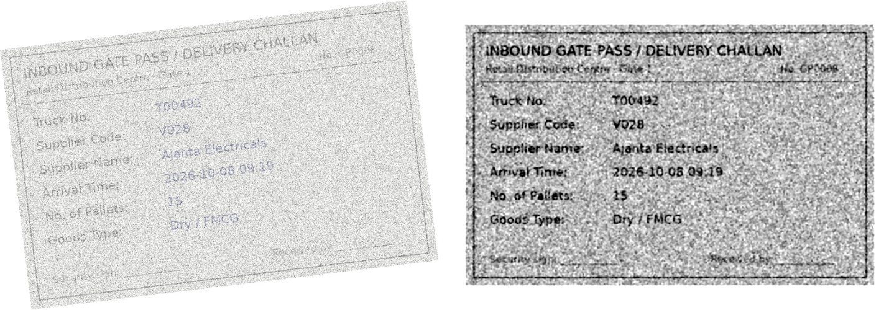

# Inbound Dock Scheduling Simulation & Yard Dashboard

A simulation of supplier trucks arriving at a retail distribution centre (DC),
used to compare four ways of deciding which truck gets the next free unloading
dock. It also produces the kind of messy logs a real yard has, cleans them,
runs SQL KPIs on them and shows the results on a dashboard. A gate-pass OCR
module reads photos of the paper gate pass each truck brings, checks them
against the supplier booking, and approves the matching ones automatically.

## The problem in one paragraph

A DC has 5 unloading docks. About 69 supplier trucks arrive a day, but they
don't arrive evenly: suppliers dispatch overnight, so most trucks reach the
gate between 7 and 11 am. Across the whole day the docks are only about
**65% busy**, yet trucks that arrive at 10 am wait **around 100 minutes**.
So the yard doesn't have too few docks overall; it has too many trucks at
the same time. The question is which scheduling rule handles that best, and
what each rule costs.

## How to run it

You need Python 3.10 or newer.

```bash
pip install -r requirements.txt     # one time
python run_all.py                   # simulate -> clean -> analyse -> OCR (~2 minutes)
streamlit run dashboard.py          # opens the dashboard in your browser
```

The OCR step needs the **Tesseract** program as well as the Python packages
(`pytesseract` only talks to it): `brew install tesseract` on a Mac,
`sudo apt install tesseract-ocr` on Ubuntu, or the installer from
[UB-Mannheim](https://github.com/UB-Mannheim/tesseract/wiki) on Windows.
No Tesseract? Run `python run_all.py --skip-ocr`.

On a Mac, use `pip3` and `python3` if `pip` / `python` don't work.
You can also run the three steps one at a time (see below), which is the
better way to learn it.

## What each file does (read them in this order)

| Step | File | What it does |
|---|---|---|
| 1 | `simulate.py` | Creates 30 days of trucks and plays them through the yard under each of the 4 rules. Writes 3 raw log files per rule into `data/raw/`. |
| 2 | `clean_and_load.py` | Cleans the 3 logs, joins them into one row per truck, checks the data makes sense, and saves it to a SQLite database `data/yard.db`. |
| 3 | `kpis.sql` | The SQL queries that calculate the KPIs (average wait, 90th-percentile wait, wait by truck type, dock utilisation, detention cost). |
| 4 | `analyze.py` | Runs the SQL, saves CSVs and charts into `results/`, reruns the simulation with 20 different random seeds, tries different slot limits, and tests adding a 6th dock. |
| 5 | `dashboard.py` | Streamlit dashboard. **Yard** tab: pick a rule and date range, see KPI tiles, wait by hour, trucks in the yard through a day, dock utilisation, trucks past free time. **Gate-pass OCR** tab: approved vs pending passes, why they're pending, OCR accuracy, and a viewer for any single pass. |
| 6 | `ocr_*.py`, `run_ocr.py` | The gate-pass OCR module (see [its own section](#gate-pass-ocr-module) and the step-by-step [OCR_WALKTHROUGH.md](OCR_WALKTHROUGH.md)). |

### Step 1: the simulation, in plain words

Each truck goes through three stages: **gate check-in** (one lane, 2-6 min) ->
**wait for a free dock** -> **unload** (chilled grocery ~30 min, packaged
FMCG ~45 min, bulky home & utilities ~75 min). We use **SimPy**, a Python
library for *discrete-event simulation*: instead of ticking a clock every
second, it jumps from one event (truck arrives, dock frees up) to the next.

The **same trucks** are replayed under every rule, so the only thing that
changes between runs is the rule. That makes the comparison fair.

The four rules:

| Code name | Rule | Real-life version |
|---|---|---|
| `fcfs` | First come, first served | What most yards do by default |
| `priority` | Chilled trucks jump the dock queue | Protects the cold chain |
| `spt` | Truck with fewest pallets goes first | "Shortest job first"; quick trucks clear the queue fast |
| `slots` | Suppliers book 30-minute arrival slots, capped at what the docks can handle; chilled trucks still go first | Dock appointment system |

For `spt`, the yard doesn't know the exact unload time in advance, so it uses
the pallet count from the supplier's booking as the estimate.

In `slots`, 15% of trucks ignore their slot and arrive whenever they like,
and the rest arrive within about 12 minutes of their slot, because that's
more realistic than perfect discipline.

### Step 2: the cleaning, in plain words

A real DC records a truck in three different systems that don't agree on
formats. The simulation copies that:

| Log | Comes from | Problems we put in on purpose |
|---|---|---|
| `asn_log.csv` | Supplier booking system (ASN = Advance Shipping Notice) | None; this is the trusted source |
| `gate_log.csv` | Security gate scanner | Two date formats (`2026-10-01 06:02:37` and `01/10/2026 06:02`), double scans, 12 different spellings of the truck type ("Chilled", "perish.", "FMCG", "H&U"...) |
| `dock_log.csv` | Dock team's scanner | Dock number written as "D3" or "3"; about 1% of trucks have no unload-end scan |

What `clean_and_load.py` does about each:

- Tries both date formats and keeps whichever works
- Keeps only the first gate scan per truck (removed 38 duplicates)
- Maps every label variant onto `perishable`, `dry` or `bulky`, then checks it agrees with the supplier booking (0 mismatches)
- Fills missing unload-end times using the typical minutes-per-pallet, and **flags** those rows (`end_imputed`) so nobody mistakes an estimate for a real scan (18 per rule)
- Checks every truck's times are in order: gate in -> gate out -> unload start -> unload end (0 problems)

It prints a cleaning report, and the dashboard shows it under "Data quality".

### Step 3: the KPIs

| KPI | Meaning |
|---|---|
| Yard wait | Gate check-in to unloading start |
| Delay vs requested time | Supplier's preferred arrival to unloading start. This is the fair way to judge slots, because a slot can move a truck later than the supplier wanted. |
| 90th-percentile wait (P90) | 9 out of 10 trucks wait less than this. Shows the bad days that an average hides. SQLite has no percentile function, so the query ranks rows with `ROW_NUMBER()`, a window function. |
| Chilled trucks waiting >45 min | Cold-chain risk |
| Dock utilisation | Share of the 6 am - 10 pm window a dock spent unloading |
| Detention cost | Trucks get 2 hours free; after that we assume ₹400 per truck-hour (an assumption, not a real tariff) |

## Results

All numbers are averages over **20 random seeds** (20 different simulated
months), so they aren't the luck of one run. The single-month numbers
(seed 42) used by the dashboard are in `results/policy_summary.csv`.

| Rule | Avg yard wait | Delay vs requested time | Chilled truck wait | Bulky truck wait |
|---|---|---|---|---|
| First come, first served | 61.7 min | 61.7 min | 61.4 min | 61.9 min |
| Perishables first | 55.2 min | 55.2 min | **12.7 min** | 73.8 min |
| Fewest pallets first | 42.7 min | 42.7 min | 15.2 min | **104.9 min** |
| Booked slots (6.5 trucks/hour) | **20.1 min** | **71.9 min** | 10.2 min | 24.5 min |



### What the results mean

1. **Perishables first** is almost free for chilled goods: their wait drops
   79% (61 -> 13 min) and the share of chilled trucks waiting over 45 minutes
   falls from about half to almost none. The cost is that dry and bulky
   trucks wait about 19% longer.

2. **Fewest pallets first** has the best average of the three queue rules
   (-31%), but it does it by making big trucks wait: bulky trucks wait 69%
   longer (62 -> 105 min) and detention cost goes *up*, because those
   trucks go past their 2-hour free time. A better average isn't always a
   better yard.

3. **Booked slots** look amazing on yard wait (-67%), but the delay versus the
   time the supplier wanted goes *up* (62 -> 72 min). The booking system
   pushes morning trucks into later slots, so the waiting happens
   on the road or at the supplier instead of in our yard. Rearranging when
   trucks come can't create dock capacity.

   

4. **So how many trucks should each hour's slots accept?** `analyze.py`
   tries 6.5 to 10 trucks per hour. Accept too few and suppliers get pushed
   late; too many and the yard queue comes back. At **7.5 trucks/hour**,
   the average yard wait is **34 min instead of 62 (-46%)** while suppliers
   are delayed no more than under first come, first served (61.5 vs 61.8 min).
   That's the balanced setting.

   

5. **What is a 6th dock worth?** With perishables first, adding a 6th dock
   cuts the average yard wait from 55 to 29 minutes and the P90 from 153 to
   87. That's the number to put next to the cost of building and staffing a
   dock (or a temporary morning-only dock team).

6. Under first come, first served, the suppliers who wait longest are the
   ones arriving around 10-11 am on average (see `results/worst_vendors.csv`).
   They are the first suppliers to move onto slots.

### Recommendation

Start with **perishables first** (no cost, protects the cold chain), then
roll out **slots at about 7.5 trucks/hour**, starting with the suppliers who
arrive in the 9-11 am peak. Only consider a 6th dock if the slot system can't
shift enough trucks out of the morning.

## Gate-pass OCR module

### The problem

Every truck hands the guard a paper **gate pass / delivery challan** with
its truck number, supplier, arrival time and pallet count. Typing that in
by hand is slow (it adds to the gate queue) and causes typos. The idea:
photograph the pass, let OCR read it, and only send the passes that don't
match the supplier's booking to a person.

| Step | File | What it does |
|---|---|---|
| 1 | `ocr_generate.py` | Draws 200 gate passes with Pillow from the slot-booking run. 25% are made **hard** (2-3 of: tilted 3-10 deg, blurred, faded, grainy). A few have real problems on purpose: wrong pallet count (19), truck that never booked (4); 17 trucks really arrived outside their slot in the simulation. The true printed values go to `data/ocr/ground_truth.csv`. |
| 2 | `ocr_preprocess.py` | OpenCV cleaning: grayscale -> denoise (only if the image measures as grainy) -> contrast stretch -> Otsu threshold -> deskew (projection-profile). |
| 3 | `ocr_read.py` | Runs Tesseract on every image twice, **raw** and **preprocessed**, pulls the 4 fields out with regular expressions, saves them to table `ocr_reads`. |
| 4 | `ocr_validate.py` | Joins the reads to the booking in SQL. All 4 fields match -> **approved**; otherwise **pending verification** with the reason. Saves `gate_pass_checks`. |
| 5 | `ocr_accuracy.py` | Field-level accuracy, clean vs hard, raw vs preprocessed (`ocr_accuracy`). `--ablation` adds one cleaning step at a time. |



### Results (200 passes, Tesseract 5.3)

**Field-level accuracy** = % of passes where that field is *exactly* right.

| Images | Input | Truck no. | Supplier | Arrival time | Pallets | **Avg field** | All 4 right |
|---|---|---|---|---|---|---|---|
| Clean (150) | raw | 92.7 | 100.0 | 100.0 | 84.0 | **94.2** | 77.3 |
| Clean (150) | preprocessed | 100.0 | 96.7 | 100.0 | 100.0 | **99.2** | 96.7 |
| Hard (50) | raw | 44.0 | 40.0 | 42.0 | 48.0 | **43.5** | 34.0 |
| Hard (50) | preprocessed | 74.0 | 72.0 | 78.0 | 74.0 | **74.5** | 64.0 |
| All (200) | raw | 80.5 | 85.0 | 85.5 | 75.0 | **81.5** | 66.5 |
| All (200) | preprocessed | 93.5 | 90.5 | 94.5 | 93.5 | **93.0** | 88.5 |

**What each cleaning step adds** (hard images, `python ocr_accuracy.py --ablation`):

| Pipeline | Avg field accuracy |
|---|---|
| Raw colour photo | 43.5% |
| + grayscale | 43.0% |
| + denoise (only if grainy) + contrast stretch | 65.0% |
| + deskew (final) | **74.5%** |
| Final, but handing Tesseract our Otsu black/white image | 70.5% |

**Gate-pass checks** (preprocessed OCR):

| | Count |
|---|---|
| Auto-approved | **143 of 200 (71.5%)**; with raw OCR it would be 101 (50.5%) |
| Pending verification | 57 |
| Real problems caught | **40 of 40** (36 with the exact reason; 4 couldn't be read, so they were flagged as "unreadable field") |
| False alarms (a correct pass the OCR misread) | 17 (59 with raw OCR) |
| Real problems wrongly approved | **0** |

Why passes were pending (a pass can have more than one reason): arrived
outside slot 18, pallet count mismatch 17, unreadable field 15,
supplier mismatch 6, unknown truck 4.

### What the OCR results mean

1. **Preprocessing matters most on bad photos.** Hard images go from 43.5%
   to 74.5% field accuracy. By damage type: grainy 24 -> 58%, blurred
   43 -> 83%, tilted 46 -> 76%, faded 35 -> 56%. Faded + grainy together
   is still the weakest case.
2. **It even helps clean images** (94.2 -> 99.2%). The raw photo has blue
   ink on cream paper, and Tesseract's own black/white conversion sometimes
   lost the pallet number ("Pallets: Bul" instead of 31). Grayscale plus a
   contrast stretch fixes that.
3. **More cleaning isn't always better.** A 5x5 median filter on every
   image erased the thin '-' and ':' in clean dates, so arrival time
   accuracy on clean images fell to 0%. That's why the filter now runs only
   when a quick grain measurement says the image is noisy.
4. **We threshold, but we don't hand Tesseract the thresholded image.** Otsu
   black/white is what we measure the tilt on, but feeding it to Tesseract
   scored 4 points worse than the cleaned grayscale page: one global cut-off
   breaks up blurred strokes, and Tesseract's own local thresholding does better.
5. **Validation is the safety net, not accuracy.** OCR gets 7% of fields
   wrong, yet no wrong pass was approved: a misread almost never turns into
   *another truck's exact booking* on all four fields. A misread costs a
   manual check (17 false alarms), never a wrong approval.
6. **The leftover clean-image errors are a known Tesseract habit.** Its
   language model sometimes turns codes into words ("V016" -> "vole").
   The next fix is to crop each field and read it alone with a digits-only
   character list.

**Honesty check.** I tuned the preprocessing while looking at these same
200 images, so I also ran it on a fresh set of 200 (different seed, never
looked at): clean 99.2% (raw 96.2%), hard 69.5% (raw 44.5%). The hard-image
number drops 5 points, so treat ~70% as the realistic figure.

### OCR assumptions and limits

- The passes are drawn by the program, so every pass has the same layout
  and font. Real passes come from many suppliers in many layouts, often
  handwritten; Tesseract is weak on handwriting.
- The damage is simulated. A real phone photo also has shadows, perspective
  (the page isn't flat) and parts cut off.
- "Approved" needs all four fields to match. A real yard might also check
  the vehicle registration plate and seal number.

## Assumptions and limits (be ready to say these yourself)

- The data is simulated, not from a real DC. The arrival pattern, unload
  times and ₹400/hour detention charge are reasonable guesses, and they're all
  set at the top of `simulate.py` and `clean_and_load.py` so you can change them.
- Docks don't break down and every dock can take every truck type. A real
  yard might have chilled-only docks.
- The gate has one lane. It adds about 5 minutes on average (22 at worst), so
  the docks, not the gate, are the bottleneck here.
- Slot behaviour (15% ignore their slot, the rest are within ~12 minutes) is
  an assumption. If more suppliers ignore slots, the benefit shrinks.
- Each policy is a fixed rule. Real yard managers also use judgment.

## Possible interview questions, with plain answers

**Why a simulation and not just a formula?**
Queueing formulas assume trucks arrive at a steady average rate. Here
arrivals bunch up in the morning and unload times differ by truck type, so
a formula would underestimate the morning queue. A simulation copies what
actually happens, truck by truck.

**Why run 20 seeds?**
One simulated month could be unusually good or bad. Running 20 different
months and averaging shows whether a result is real. For example, FCFS
average wait ranged from 47 to 71 minutes across the 20 months, so a single
run could easily mislead.

**Why is the average not enough?**
Fewest-pallets-first had a good average but made bulky trucks wait 105
minutes. That's why I also tracked P90, wait by truck type and detention cost.

**How did you check the cleaned data was right?**
Every booked truck had to have one gate and one dock record, times had to be
in order, and the gate's truck type had to agree with the supplier booking.
All three checks came back clean. Estimated values are flagged, not hidden.

**What would you need to build this for a real plant?**
Live data from the gate system, weighbridge, and dock or unloading area
(often already in a plant historian or ERP), the real arrival pattern and
unload times from a few weeks of history to calibrate the model, and a way
for suppliers or transporters to book slots.

**What would you do next?**
Calibrate with real data, add docks that only handle certain truck types,
model breakdowns, and test what happens when more suppliers ignore their slots.

**(OCR) Why generate fake gate passes instead of using real ones?**
To score OCR you need to know the right answer for every field. With
synthetic passes I know exactly what is printed, so I can measure accuracy
field by field and also check whether the validation rules catch the
problems I planted.

**(OCR) Why not just trust the OCR when it's 93% accurate?**
93% per field means only 88.5% of passes are fully right, so about 1 pass in
9 would go into the system with a mistake. Checking against the booking
turns that into "approve the matches, look at the rest": 71.5% go straight
through and no wrong pass was approved.

**(OCR) What would you change for a real yard?**
Read each field from its own cropped box with a digits-only character
list, try a deep-learning OCR (PaddleOCR or a cloud API) for handwritten
passes, and log every manual correction so the rules can be tuned.

## Words you might be asked about

- **Discrete-event simulation**: a model that jumps from event to event (arrival, start, finish) instead of ticking through every second
- **SimPy `PriorityResource`**: a set of identical servers (our docks) where the waiting line is sorted by a priority number; a lower number goes first
- **Non-preemptive**: once a truck starts unloading, nobody can kick it off the dock, even a chilled truck
- **Detention**: a charge for keeping a truck waiting past its free time
- **ASN (Advance Shipping Notice)**: the supplier's message saying what's on the truck and when it's coming
- **OCR (Optical Character Recognition)**: software that turns a picture of text into text; we use Tesseract through `pytesseract`
- **Otsu thresholding**: picks the grey level that best separates dark ink from light paper, by trying every cut-off and keeping the one where the two groups are most different
- **Deskew**: measure how tilted a page is and rotate it straight
- **Field-level accuracy**: for each field, the share of documents where it's exactly right (stricter than character accuracy: one wrong digit = wrong field)
- **Window function**: a SQL function that looks at other rows in a group without collapsing them, e.g. `ROW_NUMBER() OVER (PARTITION BY policy ORDER BY wait)`

## Putting it on GitHub

The resume links to `github.com/Praneethj39/dock-scheduling-sim`, so create a
repo with exactly that name, then from inside this folder:

```bash
git init
git add .
git commit -m "Dock scheduling simulation and yard dashboard"
git branch -M main
git remote add origin https://github.com/Praneethj39/dock-scheduling-sim.git
git push -u origin main
```
